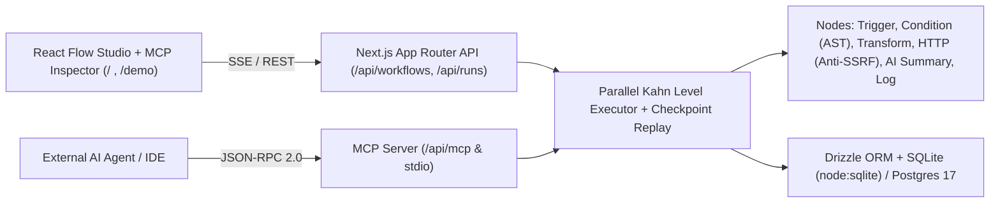

# FlowForge DAG — Visual Workflow Engine & MCP Server

[](https://github.com/diego/flowforge-dag/actions/workflows/ci.yml)

**FlowForge DAG** is a standalone visual DAG automation studio powered by React Flow (`@xyflow/react`), parallel Kahn topological level execution, per-node checkpoint replay, SSRF-hardened HTTP nodes, and an integrated **Model Context Protocol (MCP)** server (`POST /api/mcp` + stdio).

- **Live Studio**: `/`
- **1-Click Interactive Demo**: `/demo`
- **Workflows & Run History**: `/workflows`
- **OpenAPI 3.1 Docs**: `/api/docs`

## Architecture



## Architecture Decision Records (ADRs)

1. **Parallel Topological Levels via Kahn + `Promise.allSettled`**: Grouping zero-in-degree nodes per wave (`computeTopologicalLevels`) enables safe concurrent execution of independent branches while preserving deterministic ordering, conditional `true`/`false` branch skipping, and Tarjan SCC cycle isolation.
2. **Checkpoint Persistence & Partial Replay**: Every node persists `inputJson` and `outputJson` in `node_execution_logs`. `POST /api/runs/[runId]/replay-from/[nodeId]` reuses upstream `outputJson` checkpoints and only re-executes the target node and its downstream subgraph.
3. **Dual-Transport MCP Server (`POST /api/mcp` + stdio)**: Exposes `list_workflows`, `validate_dag`, `run_workflow`, and `get_run_logs` through a single Zod-validated JSON-RPC 2.0 dispatcher shared by HTTP and CLI stdio.

## Quick Setup (3 Steps)

```bash
pnpm install
pnpm db:migrate && pnpm db:seed
pnpm dev
```

Open `http://localhost:3006` (or `http://localhost:3006/demo` for 1-click execution).

## Honest 100 → 100k Scale Trade-offs

1. **In-Process Execution vs. Distributed Queue**: Currently DAG levels execute inside the Next.js route process with `Promise.allSettled`. At 100k concurrent runs, move level dispatch to a durable worker queue (BullMQ/Temporal) while keeping `computeTopologicalLevels` and checkpoint contracts unchanged.
2. **Embedded SQLite vs. Connection-Pooled Postgres**: Local dev and CI default to `node:sqlite` for zero-config startup; high-concurrency multi-instance deployments should point `DATABASE_URL` to Postgres 17 (`docker-compose.yml` included).
3. **In-Memory SSE vs. Pub/Sub Broker**: Live node status streams directly over HTTP SSE from the executing request; multi-replica horizontal scaling would require Redis Pub/Sub to fan out `node:start` / `node:complete` events across instances.
